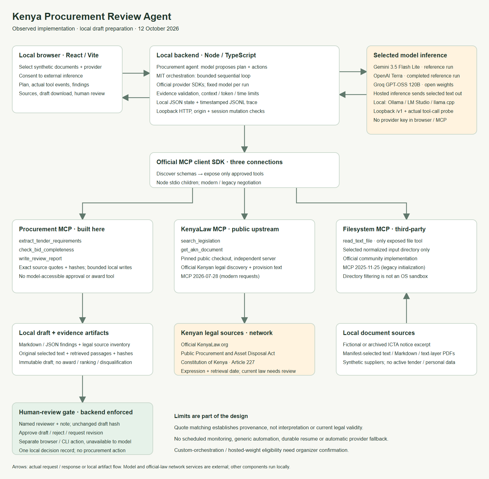

# Architecture

One local Node/TypeScript agent prepares a documentary procurement draft. React/Vite selects documents, provider/model and consent, then displays actual plans, tool inputs/outputs, findings, citations and drafts. No queue, database, graph engine or multi-agent coordinator.

MIT `runtime.ts` executes a model planning turn followed by model-selected discovered tools in a bounded sequential loop. Official OpenAI/Google SDKs implement Responses, Gemini and compatible Chat Completions. Groq GPT-OSS 120B, OpenAI, Gemini and loopback compatible endpoints share one runtime. Local endpoints require a real tool-response probe. Chat compaction retains the actual plan, labelled successful evidence and recent complete tool exchanges. Host checks bound permissions, evidence, calls, context, tokens, time and cancellation. Tool errors permit model recovery; provider failures stop without paid retries. A valid draft freezes the workspace. Custom orchestration's acceptance as equivalent remains unconfirmed.

| MCP server | Ownership | Exposed tools |
| --- | --- | --- |
| Procurement | New, built here | `extract_tender_requirements`, `check_bid_completeness`, `write_review_report` |
| KenyaLaw | Existing independent public upstream, pinned | `search_legislation`, `get_akn_document` |
| Filesystem | Independent third-party community server | `read_text_file`, complete selected reads only |

Official clients use three real Node stdio processes and discovered schemas. Observed KenyaLaw/Procurement use modern MCP 2026-07-28 per-request negotiation; Filesystem uses SDK legacy 2025-11-25 initialization. Annotations do not authorize actions; host restrictions do.

Inputs are manifest-selected synthetic UTF-8/text-layer PDFs, or archived ICTA public excerpts with fictional suppliers. Notice URL/date/hash remain visible. KenyaLaw retrieves PPADA and Constitution Article 227. IDs, normalized lines, exact quotes, hashes and timestamps bind evidence to returned text, not legal interpretation, authenticity, ambiguous currency amounts or latest amendments. Financing rules and full historical criteria need human research.

Loopback HTTP checks Host/Origin/session token. Untrusted content renders as text. Provider keys stay backend-only and are excluded from children. Selected text goes to the chosen hosted provider or local endpoint with consent. Child processes are not an OS sandbox; local user-editable JSON/JSONL is not a tamper-proof institutional ledger.

Human review is outside the model tool set. An unchanged draft, named reviewer and note are required for one approve/reject/revision record. No procurement award action exists; identity is self-reported. [Evaluations](EVALS.md) distinguish fixtures, real transports, live providers and failures; [runtime decision](docs/runtime-decision.md) records eligibility questions.
