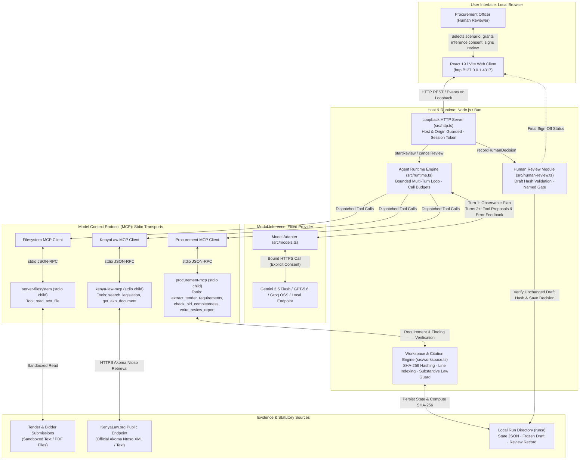
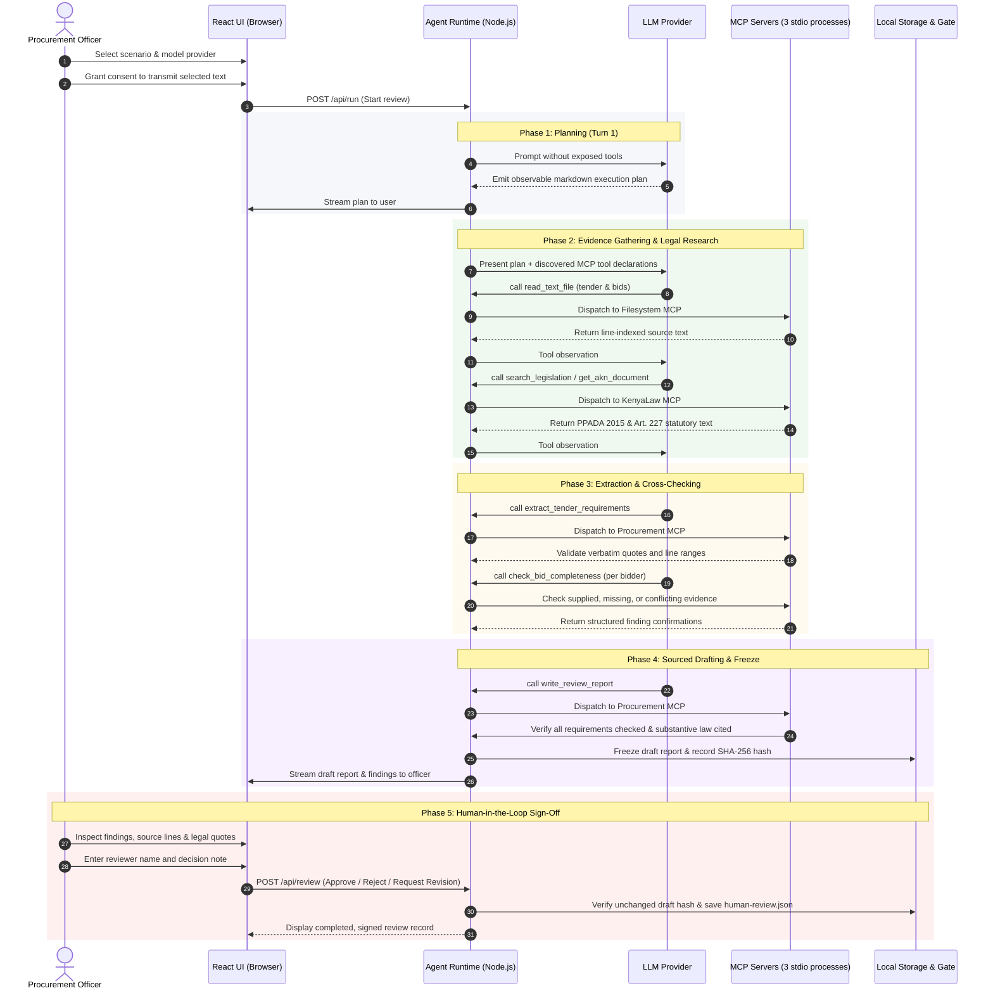

# Hakiki Architecture

Hakiki is an autonomous, inspectable AI agent that prepares a documentary review draft for a Kenyan public procurement officer evaluating ICT equipment bids. It audits supplier submissions against tender rules, technical requirements, and Kenyan statutory provisions (Public Procurement and Asset Disposal Act 2015 and Constitution Article 227).

The system runs on a direct, lightweight TypeScript runtime without black-box framework abstractions, using the Model Context Protocol (MCP) across three decoupled stdio services.

---

## System Architecture

---

## Agent Execution Lifecycle

---

## Component Architecture & Responsibilities

### 1. User Interface Layer (`web/`)
- Built with **React 19**, **Vite**, and clean vanilla CSS.
- Connects exclusively to the local loopback backend (`http://127.0.0.1:4317`).
- Renders real-time model execution plans, active tool invocations, classified findings cards (Supplied, Missing, Conflicting, Ambiguous), verbatim legal quotations, and the frozen draft report.
- Provides the human sign-off panel for recording the officer's name, decision, and notes.
- Supports complete offline inspection of past runs without active API keys or network access.

### 2. Runtime & Orchestration Layer (`src/runtime.ts`, `src/review.ts`)
- **Direct Agent Loop**: Executes a sequential turn-by-turn loop with strict parameter bounds:
  - Turn 1: Requests a plain markdown execution roadmap with no tool declarations exposed.
  - Turns 2+: Dynamically exposes tool definitions discovered from connected MCP servers.
- **Budget & Safety Enforcements**: Hard caps on maximum turns (14), maximum tool calls (20), total run duration (120 seconds), and token limits.
- **Error Feedback Loops**: Structured tool validation errors (e.g., mismatched quotation strings, missing findings, or invalid statutory URIs) are fed back to the model context, allowing the agent to self-correct.
- **Fixed Model Invariant**: The provider and model stay fixed during a run. Silent fallbacks are strictly prohibited.

### 3. Model Adapter Layer (`src/models.ts`)
- Wraps official SDKs for each supported provider:
  - **Google Gemini**: `@google/genai` (default reference model: `gemini-3.5-flash-lite`).
  - **OpenAI**: `openai` (reference frontier model: `gpt-5.6-terra`).
  - **Groq Cloud (Open-weights)**: Hosted `openai/gpt-oss-120b` via OpenAI-compatible transport.
  - **Local Loopback**: Any OpenAI-compatible local server (`127.0.0.1` Ollama or LM Studio).
- Requires explicit user consent before transmitting any document text externally.
- Strips credentials from child processes and sanitizes chat history using active context compaction (`src/chat-model.ts`).

### 4. Model Context Protocol (MCP) Layer (`src/mcp.ts`)
Hakiki connects to three independent child processes over `stdio` using official `@modelcontextprotocol/client` and `@modelcontextprotocol/server`:

| MCP Server | Origin / Package | Transport | Tools Exposed | Purpose |
| :--- | :--- | :--- | :--- | :--- |
| **Procurement** | Custom (`src/procurement-server.ts`) | stdio | `extract_tender_requirements` `check_bid_completeness` `write_review_report` | Validates tender requirements, checks bidder evidence against exact quotes, and writes the review draft. |
| **KenyaLaw** | Pinned public dependency (`kenya-law-mcp`) | stdio | `search_legislation` `get_akn_document` | Retrieves official Kenyan legislative texts in Akoma Ntoso format directly from KenyaLaw.org. |
| **Filesystem** | Official third-party (`@modelcontextprotocol/server-filesystem`) | stdio | `read_text_file` | Sandboxed, read-only file ingestion of tender documents and bids within authorized directories. |

### 5. Integrity & Citation Guard (`src/workspace.ts`, `src/procurement.ts`)
- **Document Hashing**: Every input file is normalized and assigned a unique ID and SHA-256 hash upon ingestion.
- **Exact Quotation Matching**: Tools reject any candidate requirement or evidence check whose quote cannot be verified character-for-character against the source file.
- **Substantive Statutory Clause Guard** (`isSubstantiveLegalReference`): Legal references cited in reports are strictly validated:
  - Rejects markdown headers (`#`, `##`), Akoma Ntoso metadata markers (`AKN URI:`), and bare section titles (`79. Responsiveness of tenders`).
  - Rejects incomplete introductory lead-ins ending in dashes or colons (e.g., `affected by:`).
  - Requires actual, enforceable legislative provisions from PPADA 2015 and Article 227 of the Constitution of Kenya.

### 6. Human-in-the-Loop Gate (`src/human-review.ts`)
- The agent is legally and architecturally barred from awarding contracts, ranking suppliers, or disqualifying bidders.
- Once drafted, the review report is frozen and its SHA-256 hash is stored.
- A human procurement officer must review the documentary findings and record an explicit decision:
  - `Approve`: Confirms the documentary draft for official procurement committee records.
  - `Reject`: Disregards the findings.
  - `Request Revision`: Reopens the draft for amendments.
- Human review decisions are signed with a self-reported reviewer name, timestamp, and audit notes, stored immutably in `human-review.json`.

---

## Security & Confinement Architecture

1. **Loopback Isolation**: The HTTP server binds exclusively to `127.0.0.1` and enforces strict checks on `Host` headers, browser `Origin`, and per-session tokens to prevent cross-site request forgery (CSRF).
2. **Untrusted Data Boundary**: All tender documents, bidder proposals, and MCP tool responses are treated as untrusted text. Prompt injection attempts embedded within supplier bids are flagged and ignored.
3. **No Execution Privileges**: The model is never given shell access, code execution capabilities, or arbitrary filesystem write permissions.
4. **Credential Isolation**: Local API keys (`.env`) reside strictly in the backend process memory and are explicitly stripped before spawning MCP child processes.
5. **Data Sovereignty**: For public sector compliance, Hakiki can run entirely offline using local loopback models (Ollama/LM Studio), ensuring sensitive government bids never leave the officer's workstation.

---

## Verification & Limits

- **Deterministic Test Suite**: 31 automated tests across 7 test suites verify protocol compliance, citation enforcement, runtime limits, and human gate integrity without paid API calls (`bun test`).
- **Live Empirical Evaluations**: Documented in [`EVALS.md`](EVALS.md). 8 live tasks across multiple providers demonstrate correct factual classification, with retained failure records documenting citation-coverage challenges.
- **Advisory Scope**: Hakiki identifies documentary evidence only. External human verification remains mandatory for bidder tax compliance verification (KRA), business registration status (BRS), and physical bid authenticity.
