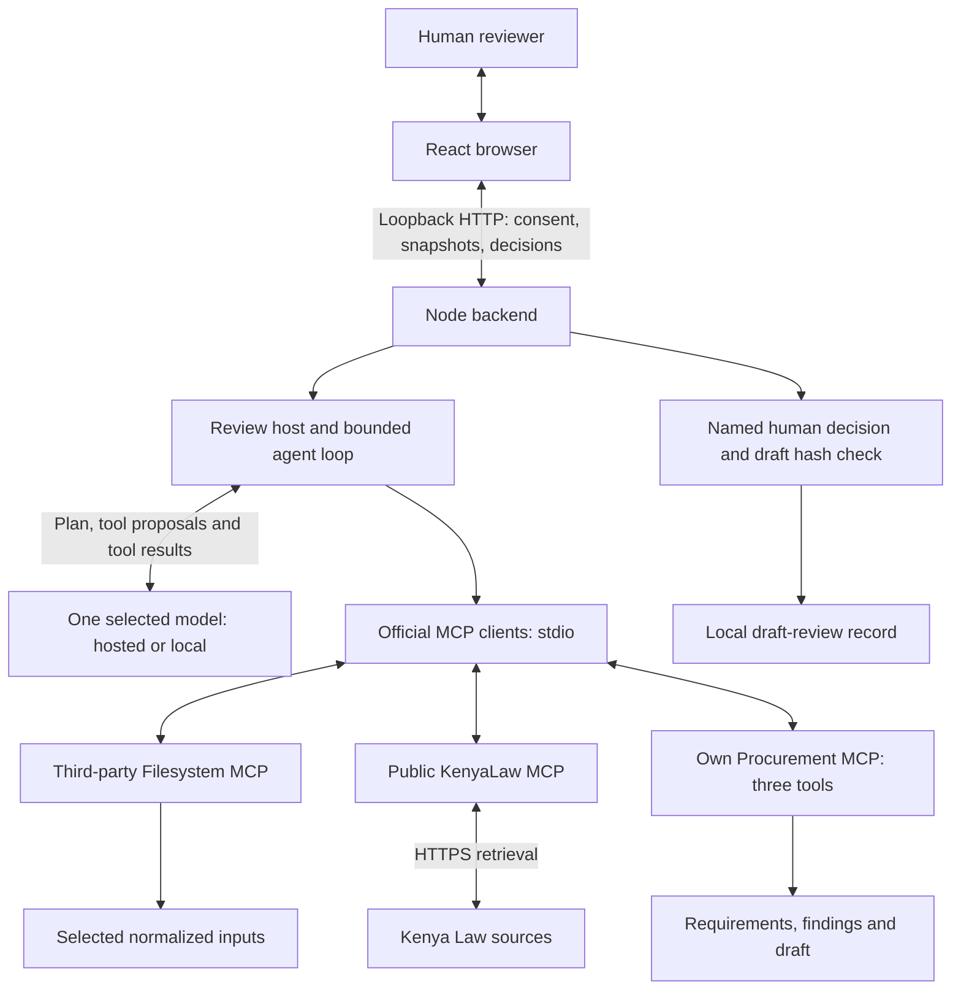

# Architecture

The browser selects documents and a model, then asks a local Node backend to run the review. One TypeScript agent chooses tools and prepares a draft. The React/Vite interface displays the saved plan, calls, findings, sources and report.

The model chooses the tool order; the backend controls access. Download the [competition diagram](docs/architecture.png) ([SVG](docs/architecture.svg)), or see the [execution and state diagrams](docs/implementation.md) for timing and failure paths.

[runAgent](src/runtime.ts) first asks the model for a plan without tools. It then executes model-selected calls one at a time, within run limits. [review](src/review.ts) connects the servers, restricts calls and requires the selected documents, a Public Procurement and Asset Disposal Act provision and Constitution Article 227 before drafting. Tool errors go back to the model for correction. Provider errors stop the run. Once a report is saved, the agent cannot change it.

[Model adapters](src/models.ts) support OpenAI, Gemini, Groq and local endpoints. Only [compatible chat](src/chat-model.ts) shortens conversation history. A local endpoint must pass the [tool-response check](src/model-probe.ts) before a review.

| MCP server | Ownership | Exposed tools |
| --- | --- | --- |
| Procurement | Built here | `extract_tender_requirements`, `check_bid_completeness`, `write_review_report` |
| KenyaLaw | Independent public project, pinned version | `search_legislation`, `get_akn_document` |
| Filesystem | Third-party server | `read_text_file`, selected files only |

The official MCP clients discover tool schemas and connect to three separate Node processes over stdio. The [protocol audit](docs/security-audit.md) records the versions tested. Tool annotations describe intent; the backend enforces permissions.

The supplied packages contain synthetic documents or an archived ICTA notice with fictional supplier files. Each source gets an ID and hash. Citations must match its normalized text lines exactly. These checks establish the source of a quotation; a human must still check its meaning, legal applicability and the full tender criteria.

The backend listens on loopback and checks the HTTP Host, Origin and session token. The browser displays untrusted content as text. Provider keys stay in the backend and are excluded from MCP child environments. Selected text goes to the chosen inference endpoint with consent. Child processes still have the user's OS permissions, and local records can be edited by that user.

Human review is handled by [recordHumanDecision](src/human-review.ts), outside the model's tools. It requires completed execution, an unchanged draft, a reviewer name and a note. The name is self-reported; approval concerns the draft only. See [workspace records](src/workspace.ts), [MCP contracts](docs/mcp-tools.md), [HTTP routes](src/http.ts) and [frontend](web/src/main.tsx) for the implementation.

## Open Questions / Things to Verify

Full local-model tasks and current legal applicability have not been verified. Competition acceptance of the custom runtime and hosted open weights also needs confirmation. [Evaluations](EVALS.md), [security audit](docs/security-audit.md) and [readiness](docs/readiness.md) record the remaining gaps.
