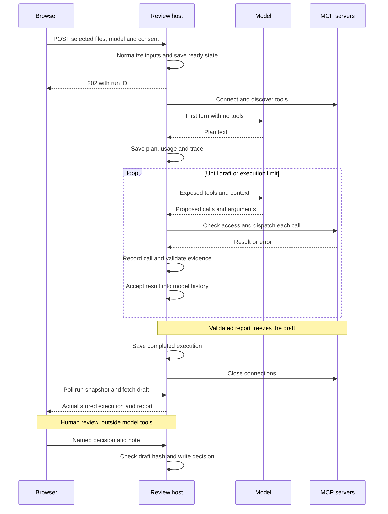
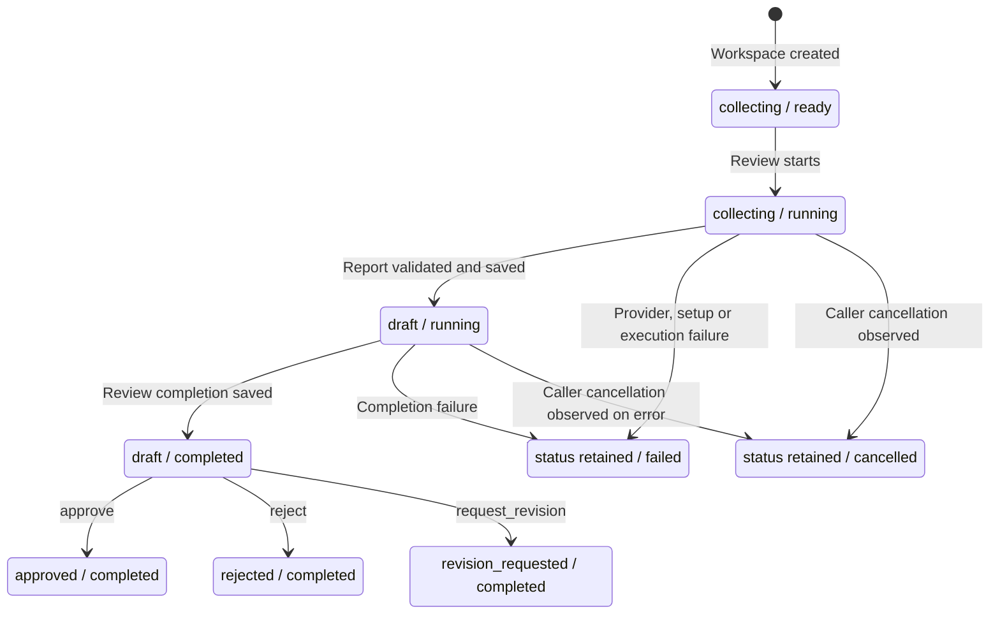

# Execution and stored state

This document follows one review from document selection to a human decision. Start with the [architecture](../ARCHITECTURE.md) for the main components.

## From selection to a draft

[createLocalServer](../src/http.ts) checks consent, selected files and model choice. It allows one active review per server process. [createWorkspace](../src/workspace.ts) validates the scenario manifest, normalizes the text and creates a directory for the run. The [CLI](../src/cli.ts) uses the same functions; its consent flag is `--send-to-provider`.

The sequence groups the three MCP servers together. The model chooses the order of document, legal and procurement calls. For local models, the tool-calling check runs before workspace creation and is omitted here.

[review](../src/review.ts) manages server connections and allowed tools. [runAgent](../src/runtime.ts) runs the loop. The first model response must contain a plan and no tool calls. The plan is saved and displayed as text; the runtime does not turn it into a checklist or track each planned step.

Later responses can propose several calls, which the backend executes one at a time. [call](../src/mcp.ts) logs actual MCP requests and responses. The runtime also logs proposed calls and the results it gives the model. A denied proposal can therefore appear in the agent log without a matching MCP request. Tool errors return to the same model for a possible correction. Provider errors stop the run without retrying or changing models. If the model stops calling tools before a draft exists, the review fails.

Once `write_review_report` saves a draft, the loop stops, even if more calls were proposed. The backend marks execution completed and closes the servers. The browser [polls every 1.5 seconds](../web/src/main.tsx), reading saved state and logs.

## Run state and human review

[RunState](../src/workspace.ts) has two fields: `execution` describes the agent run, and `status` describes the draft's review state. Diagram labels use `status / execution`. A draft can briefly exist while execution is still running.

The failure arrows cover errors caught by `review`; a failure before execution starts may leave the workspace ready. A deadline records `failed`; caller cancellation records `cancelled`. Partial files or a draft may remain in either case. Human review requires `execution: completed`.

[recordHumanDecision](../src/human-review.ts) checks the completed run, `status: draft`, unchanged draft hash, reviewer name and note. The HTTP route also blocks decisions while the run is active. One `review-decision.json` is created without overwriting an existing decision, and the draft status changes. Execution remains completed. Names are self-reported. Rejection or revision requires a fresh run; it does not resume the old one. A crash can leave stored execution marked running, with no automatic recovery.

## Data and artifacts

Each run is stored as local files. Provider adapters keep conversation history in memory.

| Artifact under `.runs/<uuid>/` | Writer and purpose |
| --- | --- |
| `inputs/<document-id>.txt` | `createWorkspace`: normalized selected files; hashes and import limits in state |
| `sources/law-N.txt` | [registerLegalSource](../src/mcp.ts): retrieved text, hash, URI and retrieval time |
| `state.json` | Workspace, runtime, review and Procurement tools: selection, plan, usage, requirements, findings and both state fields |
| `trace.jsonl` | [event](../src/mcp.ts): timestamped connection, model, tool and decision records |
| `output/draft.md`, `output/findings.json` | [writeReport](../src/procurement.ts): findings and checked references; fixed paths, no overwrite |
| `review-decision.json` | `recordHumanDecision`: reviewer, decision, note and draft hash |

Selected documents and retrieved law get source IDs and hashes. Requirements and findings cite those IDs, line ranges and quotations. [validateReference](../src/workspace.ts) rereads the file, checks its hash and matches the quote within the given lines. See [classification and reference rules](mcp-tools.md). A matching quote establishes its source, not the correctness of the conclusion.

Logs contain document and tool text and stay ignored by Git. Public [evaluation summaries](evaluations) contain selected run metadata; raw logs and signed provider receipts are not published. The browser reads state and logs separately, so one snapshot may combine different moments of a run. State-file replacement is atomic, but report and decision writes span several files and can leave partial results on failure.

## Provider behavior and limits

All adapters implement the [Model interface](../src/models.ts): `turn(tools, signal)` returns text, calls and usage; `accept(call, output)` adds a tool result for the next turn. The selected provider stays fixed.

| Adapter | Context handling |
| --- | --- |
| OpenAI Responses | Keeps provider output items, including reasoning and calls, then adds tool results; `store: false` |
| Gemini | Keeps content and signatures, then adds tool responses; waits between requests |
| Groq / local compatible chat | [createChatModel](../src/chat-model.ts) keeps the plan, labelled successful evidence and the latest two complete exchanges; Groq response headers control request spacing |

[probeLocalModel](../src/model-probe.ts) makes two requests: one asks for a structured tool call, and the next checks that the model used a new receipt from the response. The browser and CLI run this before a local review. It tests that exchange only; full tasks on installed local models remain untested.

Run limits are 20 model turns, 40 proposed tool calls and 160,000 cumulative tokens checked between turns. Adapters reject context over 240,000 characters and request at most 6,000 output tokens. Ordinary reviews have four minutes; the [open-weight script](../scripts/open-weight-review.ts) allows fifteen.

MCP connection/discovery times out after 20 seconds; calls after 60 seconds. Arguments and responses also have size limits. Connection setup uses its own timeout rather than the run's cancellation signal. A model response can exceed the remaining token budget, so these limits do not guarantee a maximum cost.

When changing a diagram, check the linked code and render it. Mermaid documents [sequence](https://mermaid.js.org/syntax/sequenceDiagram.html) and [state](https://mermaid.js.org/syntax/stateDiagram.html) syntax.

## Open Questions / Things to Verify

- Should a draft be allowed when legal retrieval fails? The prompt asks the model to report retrieval limits, but `review` requires PPADA and Article 227 before drafting. The standalone report tool does not enforce this policy; see [MCP boundaries](mcp-tools.md).
- A full hosted open-weight task has not succeeded, and installed local-model tasks have not been tested. See [EVALS](../EVALS.md).
- Crash recovery, all-or-nothing multi-file writes and hard token/cost caps are not implemented. Incomplete runs need a fresh run.
- Competition eligibility and legal applicability need confirmation; see [readiness](readiness.md) and [security](security-audit.md).
