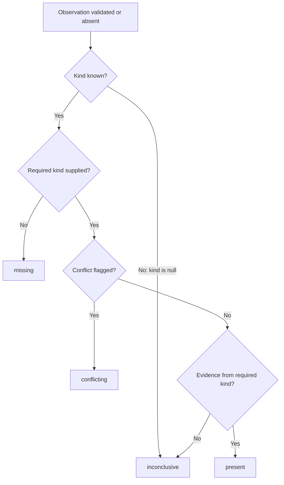
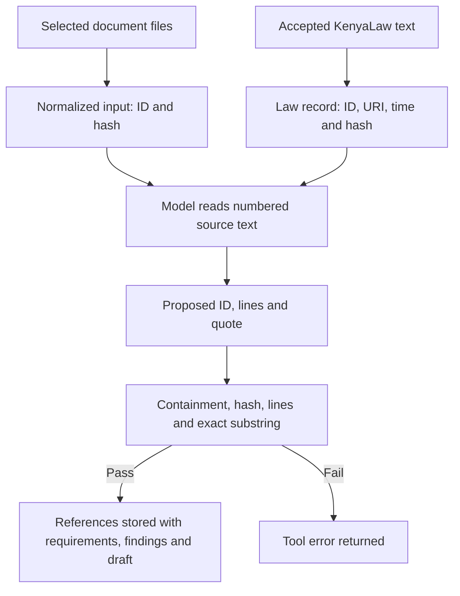

# Procurement MCP contracts

The agent starts this server for each run. To connect another MCP client, first create a fresh workspace with [createWorkspace](../src/workspace.ts), set `REVIEW_RUN_ROOT` to the returned directory, then start `node dist/procurement-server.js`. For example, after building, in PowerShell:

```powershell
$runRoot = node --experimental-strip-types --input-type=module -e "import {resolve} from 'node:path'; import {createWorkspace} from './src/workspace.ts'; console.log(await createWorkspace(resolve('fixtures/scenario.json'), resolve('.runs')));"
$env:REVIEW_RUN_ROOT = $runRoot
node dist/procurement-server.js
```

Connect through stdio using an MCP client. `tools/list` returns input/output JSON schemas. The official SDK handles modern and legacy MCP. The [CLI](../src/cli.ts) `sample` command creates a workspace **and runs the agent**; it is not a setup-only command.

| Tool | Input | Behavior | Limit |
| --- | --- | --- | --- |
| `extract_tender_requirements` | Tender ID, proposed requirements, categories, uncertainties and source references | Checks quotes/hashes and returns IDs. Identical extraction preserves IDs and findings | New requirements clear old findings. Unclear categories must be null; extraction completeness needs review |
| `check_bid_completeness` | Supplier ID and observations for requirements | Checks supplier ownership and quotes; computes present/missing/conflicting/inconclusive for every requirement | Uses manifest file categories; does not authenticate documents or verify compliance |
| `write_review_report` | Every finding once, interpretation, uncertainty, law references and scope notes | Rechecks sources, writes Markdown/JSON and freezes the draft | Fixed output paths, no overwrite. Law references use `law-N` IDs. Cannot approve a draft |

[createServer](../src/procurement-server.ts) registers the tools and output schemas. [procurement.ts](../src/procurement.ts) contains input schemas and the handlers `extractRequirements`, `checkCompleteness` and `writeReport`. The calling model proposes requirements; the extraction handler checks and stores them without another model call.

## How a classification is computed

[checkCompleteness](../src/procurement.ts) checks supplied observations, then applies this decision order to each requirement. The model supplies references and a conflict flag; the handler computes the classification.



Before classification, references must belong to the supplier and match unchanged source text. A conflict flag needs two distinct quotes. The handler does not prove they contradict each other or require them to come from different documents. It also does not authenticate certificates or test warranty lengths against a threshold. `present` means evidence was supplied. Every requirement gets a finding, even without an observation.

Repeating the same category and reference keeps the requirement ID and existing checks. Adding a requirement clears prior findings. Checking a supplier replaces that supplier's findings only. A report must include every supplier/requirement finding exactly once and uses the stored classifications.

## References and enforcement boundaries

A reference is `{document_id, line_start, line_end, quote}`. [validateReference](../src/workspace.ts) finds the registered file, checks its hash and matches the quote within the given text lines. Line numbers are positive and ordered; the range covers at most 21 lines, including both ends. Matching preserves whitespace and line breaks.

Schemas reject extra properties and limit string/array sizes. Tool errors use `isError: true`; protocol errors remain separate failures. [call](../src/mcp.ts) logs MCP inputs, outputs and timestamps. See the [security audit](security-audit.md).

Only retrieved law text can become a law source. Search results and starting URI hints are not citation evidence.



These checks establish where a quote came from, not whether the conclusion is correct. Line numbers refer to normalized text, not PDF pages.

| Rule | Where enforced |
| --- | --- |
| Read all selected files; retrieve a PPADA provision and Article 227 before drafting | [review](../src/review.ts), the agent backend |
| Official legal URL, individual sections/articles and a 12,000-character text limit | `review`, with [officialLegalUrl](../src/mcp.ts) |
| Check sources/hashes and complete findings; restrict writes and freeze the draft | Procurement handlers and `validateReference` |
| Require a name and note for a completed, unchanged draft | [recordHumanDecision](../src/human-review.ts), outside MCP |

An independent Procurement MCP client must enforce its own read and legal-retrieval policies. The server checks supplied `law-N` references, but permits findings without law references and states that no statutory conclusion is established. A registered source ID alone does not prove that a law is relevant or that extraction is complete.

The server works on one local run directory. It has no multi-user access control and should not be exposed as a public service. Other clients can create a workspace, discover the tools and supply source references. Human decisions are outside the tool set. Tool annotations do not grant permissions.

## Open Questions / Things to Verify

Requirement categories, extraction completeness, conflicts and legal interpretation need human review. Manifest categories are supplied by the caller. An independent client must decide which backend policies to enforce. Report writes can leave partial files on failure, with no overwrite or automatic recovery. See [execution and stored state](implementation.md).
